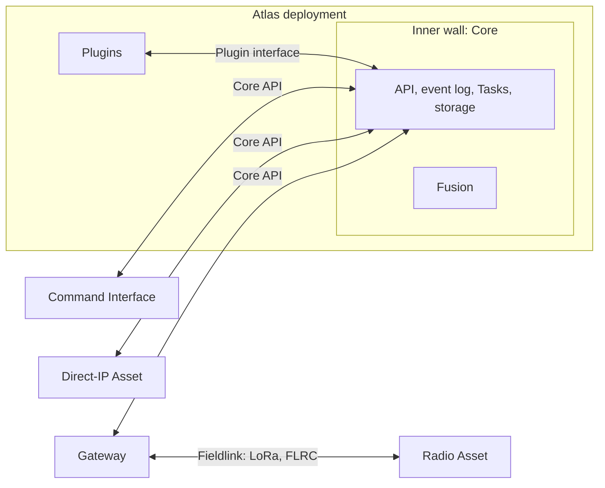

# Proposal: a Core API with gateways

**Direction selected by the owner; not yet applied.** The rest of the repository
still describes the earlier design. Each change below lands through its owning
docs in later PRs.

## The problem

Today every link uses one message model: the operator's browser, Core, gateways
and the radio mesh all send the same messages with the same identity, duplicate
and acknowledgement rules ([Communication](https://github.com/atlas-field-systems/atlas/blob/main/protocol/docs/communication.md)).
Most of those rules exist to survive a lossy radio, yet every IP program carries
them: message identity on every message, unchanged forwarding, a bounded memory
of seen messages, acknowledgements that are sometimes replies and sometimes
reports, reply-ended queries, keys in the hello, and one link per ID. A browser
refresh restarts the operator's counter and a second tab replaces the first link.

## The shape

Atlas is a walled city with three rings.

- **Inside the inner wall:** Core and Fusion, in one process. Fusion reads and
  writes Core's state directly and never goes through the public API.
- **The second ring:** Plugins. They run beside Core in its deployment and reach
  it only through Core's Plugin interface, never its storage.
- **Outside the city:** gateways, Assets and the Command Interface. They reach
  Core only through the public Core API.

The parts:

- **Protocol** owns the records (Task, settings, telemetry and the rest), the
  data laws, the validator, and the examples every implementation tests against.
  It no longer defines how programs talk.
- **Core** owns the API: HTTP for requests, Server-Sent Events for live changes.
  Request and event bodies are Protocol records.
- **The SDK** is a client for the Core API.
- **Gateways** uplink to the Core API and run the Fieldlinks their hardware
  supports. A gateway is not an Asset.
- **Fieldlinks** carry Atlas across a field link. The same Fieldlink package runs
  on both ends: in the gateway and on the radio Asset.

## Core keeps one event log

Core appends every accepted request and every Asset report to an ordered event
log with a rising integer `event_id`. Current-state tables are derived from it.
Live updates, history, recovery after a refresh, and the Reset archive are all
reads of that log.

- The log is stored on disk in SQLite. Core keeps current state, not the log,
  in memory.
- A reader follows the log from a cursor. A slow or disconnected reader is
  dropped and resumes from its last `event_id`; Core never buffers its backlog.
- Retention follows [Scale](scale.md#runs-and-storage): a run's events are
  archived, then removed after the retention period.

## The Core API (sketch)

Names are illustrative. Core owns the exact API doc.

| Request | Purpose |
| --- | --- |
| `POST /login` | Account login; returns a session cookie |
| `GET /assets`, `GET /assets/{id}` | Assets with their description, latest reports and settings |
| `GET /assets/{id}/tasks` | Task bodies, states and queue order |
| `POST /assets/{id}/tasks` | Create a Task; Core assigns `task_id`. `now: true` clears the queue and runs it |
| `PUT /assets/{id}/queue` | New order, with the `queue_version` it was built on |
| `PATCH /assets/{id}/settings` | Immediate settings change, as end states |
| `POST /assets/{id}/tasks/{task_id}/cancel` | Cancel that Task, and only that Task |
| `GET /history?asset_id&report&since&until&cursor` | Paged history |
| `GET /events` (Server-Sent Events) | Live log events; reconnect resumes after `Last-Event-ID` |
| `POST /assets/{id}/reports` | Asset or gateway reports, in batches, keeping original times |

- **Accepted is not done.** A create or change returns Core's acceptance. Task
  state and setting values change only from the Asset's reports.
- **Every command is a Task**, so immediate commands report outcomes too. Pause
  remains a setting.
- **Retries are safe by design.** Creates carry an idempotency key, settings are
  end states, cancel names its Task, and the queue carries its version.
- **A queue reaches an IP Asset whole:** its version and every Task body in one
  event. A gateway may split it on its radio.
- **Compatibility is visible.** The API reports the hash of its Protocol
  definitions; a client refuses a mismatch with an explanation.

## Identity and security

- **Accounts.** Admin and operator accounts with hashed passwords and HttpOnly
  session cookies. Admins provision accounts, Assets and gateways. Each browser
  tab uses the same session.
- **Provisioned Assets and gateways.** An admin adds one in Core and receives its
  ID and key for its configuration. The key is a bearer token over TLS. There is
  no enrollment key.
- **IDs.** Admins choose `asset_id`, which people read. Core assigns Task, geo
  feature, Object and Track IDs. Event IDs are integers.
- **Transport security.** TLS on IP. Each Fieldlink uses its radio's own
  encryption and authentication. Records never carry credentials.

## Assets and failsafes

The Asset holds its complete queue, runs its Tasks, reports observed outcomes,
and owns its failsafes. During a failsafe, operators can still command hold,
land now or return home; the Asset records these as overrides. Longer-running
failsafe behavior stays deferred until field testing.

## Fieldlinks

For the LoRa phase, the Fieldlink builds on Meshtastic: a private channel, a
private app port, and its encryption, routing and per-hop acknowledgements.
The Fieldlink adds end-to-end acknowledgement of queues and final reports,
idempotency by `task_id`, and per-Asset contact reports to Core. Frames use
CBOR with integer keys taken from the definitions, and each link checks the
definitions hash when it opens. FLRC follows with its own Fieldlink. Gateway
design is otherwise deferred.

## Stack

- **TypeScript everywhere:** Core, the SDK, gateways, Fieldlinks, the Asset app
  and the Command Interface. Node 24 runs `.ts` directly, so there is no build
  step for Node programs, and every program uses Protocol's one validator.
- **Docker.** Core and Fusion ship as one container running one process.
  Plugins run in workers for now.
- **Storage.** SQLite.

## Scope

Freeze to first flight: Assets, Tasks, settings, telemetry, battery, failsafe
reports, history and accounts. Geo feature, Object, Plugin and Observation
definitions are parked until after first flight. The retained Core prototype is
deleted; git keeps its history. Asset tests run against ArduPilot SITL.

## Documentation

Rewrite in one pass rather than patching. One rule lives in one place, and each
part keeps one open-questions list. `communication.md` becomes the Core API doc
and a Fieldlink doc. `past-interface-ideas.md` and the SDK implementation
plan are removed until there is code to plan.

## Order of work

1. Update the Charter and design decisions to this direction.
2. Write the Core API doc and trim Protocol to records and data laws.
3. Build the Core API and event log, a client, and a direct-IP Asset flying
   first flight against SITL.
4. Add the gateway and the Meshtastic Fieldlink for the real first flight.
5. Build the Command Interface on the client.
