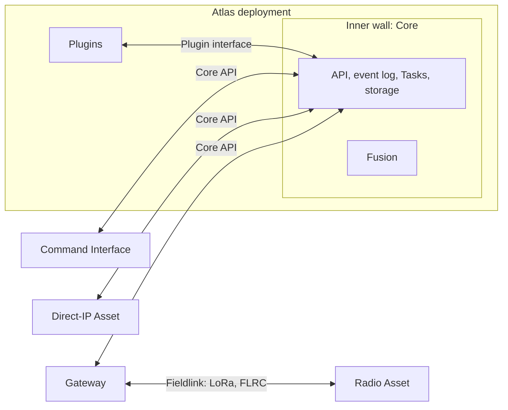

# Proposal: a Core API with gateways

**Direction selected by the owner.** The Charter, design decisions and every
part's docs follow it; this page records why.

## The problem

Today every link uses one message model: the operator's browser, Core, gateways
and the radio mesh all send the same messages with the same identity, duplicate
and acknowledgement rules ([Communication](https://github.com/atlas-field-systems/atlas/blob/c0502b7/protocol/docs/communication.md)).
Most of those rules exist to survive a lossy radio, yet every IP program carries
them: message identity on every message, unchanged forwarding, a bounded memory
of seen messages, acknowledgements that are sometimes replies and sometimes
reports, reply-ended queries, keys in the hello, and one link per ID. A browser
refresh restarts the operator's counter and a second tab replaces the first link.

## The shape

Atlas is a walled city with three rings.

- **Inside the inner wall:** Core and Fusion, in one process. Fusion reads and
  writes Core's state directly and never goes through the public API.
- **The second ring:** Plugins. They run beside Core in its deployment and reach
  it only through Core's Plugin interface, never its storage.
- **Outside the city:** gateways, Assets and the Command Interface. They reach
  Core only through the public Core API.

The parts:

- **Protocol** owns the records (Task, settings, telemetry and the rest), the
  data laws, the validator, and the examples that test record shapes.
  It no longer defines how programs talk.
- **Core** owns the API: HTTP for requests, Server-Sent Events for live changes.
  Event bodies are Protocol records; request bodies are Protocol request
  definitions.
- **The SDK** is a client for the Core API.
- **Gateways** uplink to the Core API and run the Fieldlinks their hardware
  supports. A gateway is not an Asset.
- **Fieldlinks** carry Atlas across a field link. The same Fieldlink package runs
  on both ends: in the gateway and on the radio Asset.

## Core keeps one event log

Core keeps current state in ordinary SQLite tables and, in the same transaction,
appends every accepted request and every Asset report to an ordered event log
with a rising integer `event_id`. Live updates, history and recovery after a
refresh are reads of that log. Current state is never rebuilt from it.

- Both live on disk in SQLite. Core keeps no backlog of the log in memory.
- A reader follows the log from a cursor. A slow or disconnected reader is
  dropped and resumes from its last `event_id`; Core never buffers its backlog.
- When a run ends, its events go into Core's Reset ZIP and are cleared from
  Core ([Reset](https://github.com/atlas-field-systems/atlas/blob/main/core/docs/reset.md)).

## The Core API (sketch)

Names are illustrative. Core owns the exact API doc.

| Request | Purpose |
| --- | --- |
| `POST /administration/login` | Account login; returns a session cookie |
| `GET /entities` | One cut of the shared picture: Assets, Observations, Tracks, and geo features |
| `GET /entities/assets`, `GET /entities/assets/{id}` | Assets with their description, latest reports and settings |
| `GET /tasks/{id}` | Task bodies, states and queue order |
| `POST /tasks/{id}` | Create one or more Tasks; Core numbers them with `task_id` and sends them at once. `now: true` runs one Task at once and cancels the Tasks before it |
| `PATCH /entities/assets/{id}/settings` | Immediate settings change, as end states |
| `POST /tasks/{id}/{task_id}/cancel` | Cancel that Task, and only that Task |
| `GET /history?asset_id&report&since&until&cursor` | Paged history |
| `GET /events` (Server-Sent Events) | Live log events; reconnect resumes after `Last-Event-ID` |
| `POST /entities/assets/{id}/reports` | Asset or gateway reports, in batches, keeping original times |
| `GET /entities/observations`, `GET /entities/tracks` | Evidence and conclusions in the picture, separately |
| `GET`, `POST`, `PUT`, `DELETE /entities/geofeatures` | Places operators author and Plugins create; a change replaces one whole |

Each pillar has a root path (`/entities`, `/tasks`, `/objects`,
`/administration`). Plugins have `/plugins`. Kinds live under their pillar's
root. `/about`, `/events`, `/history`, and `/debug` belong to no pillar.

- **Accepted is not done.** A create or change returns Core's acceptance. Task
  state and setting values change only from the Asset's reports.
- **Every command is a Task**, so immediate commands report outcomes too. Pause
  remains a setting.
- **Retries are safe by design.** Creates carry an idempotency key, settings are
  end states, cancel names its Task, and each `task_id` runs once.
- **Tasks are numbered and sent at once.** The Asset runs them in `task_id`
  order and starts a request's Tasks only when it has received them all. A gateway may
  send them one at a time on its radio.
- **Compatibility is visible.** The API reports the hash of its Protocol
  definitions; a client refuses a mismatch with an explanation.

## Identity and security

- **Accounts.** Admin and operator accounts with hashed passwords and HttpOnly
  session cookies. Admins provision accounts, Assets and gateways. Each browser
  tab uses the same session.
- **Provisioned Assets and gateways.** An admin adds a gateway or an Asset on IP
  in Core and receives its ID and key for its configuration. The key is a bearer
  token over TLS. There is no enrollment key. An Asset behind a gateway
  authenticates to the gateway, not to Core.
- **IDs.** Admins choose `asset_id`, which people read, when they provision an
  Asset on IP; Core assigns it for a radio Asset a gateway adds. Assets choose
  `observation_id`. Core assigns Task, Track, geo feature, and Object IDs.
  Event IDs are integers.
- **Transport security.** TLS on IP. Each Fieldlink uses its radio's own
  encryption and authentication. Records never carry credentials.

## Assets and failsafes

The Asset holds its complete queue, runs its Tasks, reports observed outcomes,
and owns its failsafes. During a failsafe, operators can still pause,
land now or return home; the Asset records these as overrides. Longer-running
failsafe behavior stays deferred until field testing.

## Fieldlinks

For the LoRa phase, the Fieldlink builds on Meshtastic: a private channel, a
private app port, and its encryption, routing and per-hop acknowledgements.
The Fieldlink adds end-to-end acknowledgement of Tasks and final reports,
idempotency by `task_id`, and per-Asset contact reports to Core. Protocol defines
no short keys, so each Fieldlink chooses its own compact encoding. Each Fieldlink
decides how an Asset authenticates to its gateway, within the rules
[every Fieldlink provides](https://github.com/atlas-field-systems/atlas/blob/main/gateway/README.md#what-every-fieldlink-provides):
a per-radio identity from the link's own cryptography and replay rejection. The gateway's link to Core is broadband
IP, so the gateway keeps its Assets' full state and sends over the radio only
what each Asset does not already have. Each link checks the definitions hash when it opens. FLRC follows with its own Fieldlink. Gateway
design is otherwise deferred.

## Stack

- **TypeScript everywhere:** Core, the SDK, gateways, Fieldlinks, the Asset app
  and the Command Interface. Node 24 runs `.ts` directly, so there is no build
  step for Node programs, and every program uses Protocol's one validator.
- **Docker.** Core and Fusion ship as one container running one process. Each
  Plugin may run in its own container. Gateways run on their own computers.
- **Storage.** SQLite.

## Scope

This proposal first froze scope to first flight. The owner then chose to
[design the whole product and build it together](design-decisions.md#design-the-whole-product-then-build-it),
with geo features, Objects, Observations, Tracks, and Plugins included. The
retained Core prototype is deleted; git keeps its history. Asset tests run
against ArduPilot SITL.

## Documentation

Rewrite in one pass rather than patching. One rule lives in one place, and each
part keeps one open-questions list. `communication.md` becomes the Core API doc
and a Fieldlink doc. `past-interface-ideas.md` and the SDK implementation
plan are removed until there is code to plan.

## Order of work

1. Update the Charter and design decisions to this direction.
2. Write the Core API doc and trim Protocol to records and data laws.
3. Design the rest of the product: the remaining Entities paths
   (`/entities/observations`, `/entities/tracks`, `/entities/geofeatures`),
   `/objects`, `/plugins`, gateways, and Fieldlinks.
4. Test the design with throwaway prototypes and write the findings back.
5. Build everything together, then fly first flight.
