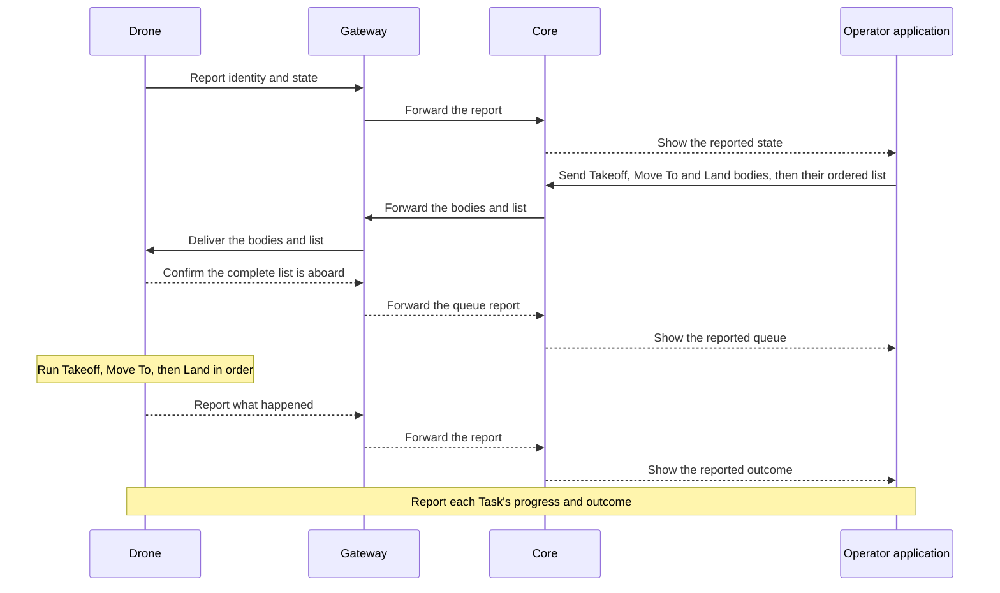

# First flight

The drone powers on and connects to Atlas through a gateway.
The operator sends the whole task list: Takeoff, Move To a location, then Land.
The drone starts the list only after it holds every Task's body.
The operator sees what the drone reports doing.

This is the selected first workflow. Takeoff and Land are planned capabilities,
not claims about the current implementation.

## The flight commands

- **Takeoff** has one input, a target altitude. The drone climbs straight up
  to it and holds there.
- **Move To** flies to a location.
- **Land** has a landing position and an optional transit altitude. The drone
  goes to that altitude, or stays at its current one, flies over the position,
  and lands.

These are simpler than MAVLink and ArduPilot commands but map onto them.
The Asset owns [platform-specific preparation and arming](https://github.com/atlas-field-systems/atlas/blob/main/asset/docs/README.md#prepare-and-take-off).

## Follow the work and its evidence

Core retains the requests and reported evidence. The Asset runtime performs the
physical action. A request reaching Core does not prove that the drone received
or executed it.

## When something goes wrong

The drone carries its whole task list before it leaves, so losing the link never
strands part of the mission on the ground. If a command fails, the drone always
cancels the remaining Tasks. For example, failed Takeoff cancels Move To and Land.
Core marks them cancelled once the drone reports it, so the records match what
happened. No configured response can preserve those cancelled Tasks.

Each Asset has [settings](settings.md) for how it responds to events such as
losing its radio link. Conditions determine when a failsafe is needed, and each
rule has a configured response Task and its parameters. A failsafe uses the same
equipment execution as an ordinary Task. The drone can keep its onboard mission
when Core rides in a car through a tunnel if no failsafe rule applies.
If it finishes its work while still out of contact and remains airborne, a
separate condition can trigger a safe response. That condition is configurable
too: the operator may intend to bring the communications link to the waiting drone.
Return to home is done by an Atlas layer above the
flight controller or by ArduPilot's return-to-home mode.

An applicable failsafe overrides ordinary work, including paused, and locks new
work for the rest of the operation, even after its response Task succeeds.
There is no in-operation recovery; the next step is shutdown and log inspection.
Atlas enables no failsafe rules by default. The flight setup explicitly supplies
the intended rules, including any battery response during an intentional wait.
The Asset owns
[the trigger conditions, cancellation rule, and remaining decisions](https://github.com/atlas-field-systems/atlas/blob/main/asset/docs/failsafes.md).

## Keep the whole run for debugging

When the operator spins them down, Core, each gateway, and each Asset each
write their own Reset ZIP. Core's ZIP holds:

- Every message in and out, in local arrival and send order, with credentials removed.
- Each Task's history: what was requested, accepted, and observed.
- Each device's last state and each Track's history.
- The run setup: devices, gateways, settings, and software versions.
- Errors, link drops, and the SDK's message-handling diagnostics.
- A plain readable summary: start and end, devices, Tasks, and outcomes.

Reset ZIPs are for after the system is used: dump them into an AI agent to give
it full context on how the system was used and any errors. Each system's
documentation defines its own ZIP contents and Reset procedure. Merging
several ZIPs into one is a separate process.

Core and Assets keep detailed local diagnostic logs alongside their normal state.
The SDK supplies events to the program using it, so those events join that
program's archive. Logging does not depend on sending diagnostic traffic over
the field link. See [Core logging](https://github.com/atlas-field-systems/atlas/blob/main/core/docs/logging.md),
[Asset logging](https://github.com/atlas-field-systems/atlas/blob/main/asset/docs/logging.md),
and [SDK logging](https://github.com/atlas-field-systems/atlas/blob/main/sdk/docs/logging.md).

This example explains one flight. Detailed Task, radio, and recovery rules
belong in their owning subsystem documentation.

[Charter home](README.md)
