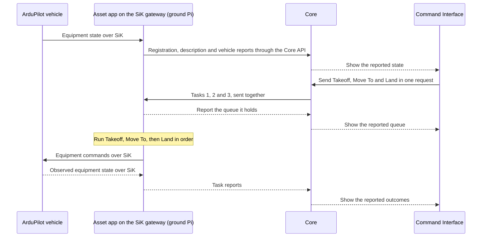

# First flight

The first setup uses a Raspberry Pi on the ground as the gateway, running the
[SiK Fieldlink](https://github.com/atlas-field-systems/atlas/blob/main/gateway/fieldlinks/sik/README.md). The gateway runs
the Asset app for an ArduPilot quadcopter and talks to it over a SiK radio link. It acts as the
companion computer from the ground, much like using a ground-control station
such as QGroundControl. The vehicle remains the Asset represented in Atlas.

The operator drafts Takeoff, Move To a location, then Land in the Command
Interface and sends them in one request. Core numbers the Tasks 1, 2, and 3 and
sends them to the Asset at once. The Asset starts Takeoff only when it holds all
three. The app sends equipment commands to the flight controller and reports the
observed outcomes. The operator sees the reported vehicle behavior.

No runtime is built yet. The Pi can reach Core while vehicle equipment is still
starting or unreachable. Connection alone does not establish takeoff readiness.
The operator can intervene locally at the Pi. Independent vehicle controls and
ArduPilot protections remain part of the setup. While they are in control,
operators [only watch](https://github.com/atlas-field-systems/atlas/blob/main/asset/docs/failsafes.md#while-the-flight-controller-is-in-control);
their values are tuned in SITL before the first flight.

## The flight commands

- **Takeoff** has one input, a target altitude. The drone climbs straight up
  to it and holds there.
- **Move To** flies to a location.
- **Land** has an optional landing position and an optional transit altitude.
  The drone goes to that altitude, or stays at its current one, flies over the
  position, and lands. Without a position, it lands where it is.

These are the copter commands. Fixed-wing aircraft would need a separate command
family and are not part of the current design. The copter commands are simpler than MAVLink and
ArduPilot commands but map onto them.
The Asset owns [platform-specific preparation and arming](https://github.com/atlas-field-systems/atlas/blob/main/asset/docs/README.md#prepare-and-take-off).

## Follow the work and its evidence

Core keeps the requests and the reported evidence in its event log. The Asset app
coordinates execution, and ArduPilot controls the vehicle. Core accepting a Task,
or the Pi holding it, does not prove that the flight controller received or
executed an equipment command. Task states change only from the Asset's reports.
The SiK connection is an equipment link, not an Atlas field link.

## When something goes wrong

The ground Pi holds the Atlas queue. Whether it uploads a complete mission
to the flight controller remains open. Continued flight after SiK loss cannot
assume an onboard Atlas queue.

If the link to Core drops but the Pi and SiK link keep working, the app retains
its queue and execution state. Configured Atlas failsafe conditions determine its
response. If SiK drops, the Pi may still report to Core, but it lacks current
vehicle evidence and cannot rely on sending a response to the flight controller.
Independent controller protections and the operator's intervention path handle
the failures they are configured to cover, including failure of the Pi itself.

A command failure cancels the remaining Tasks. For example, failed Takeoff
cancels Move To and Land. Core records cancellations when the app reports them.
Detected independent autopilot failsafe takeover also cancels ordinary work and
locks it for the operation. No configured response preserves cancelled Tasks.

Atlas [settings](settings.md) configure local conditions and response Tasks.
A response uses the same equipment execution as ordinary work. Return to home
can use Atlas execution or ArduPilot's own behavior, as selected for the setup.
A requested response is not proof that the vehicle returned or landed.

An applicable failsafe overrides ordinary work, including paused, and locks new
work for the rest of the operation, even after its response Task succeeds.
During a failsafe the operator can still
[override it](https://github.com/atlas-field-systems/atlas/blob/main/asset/docs/failsafes.md#lock-ordinary-work-for-the-rest-of-the-operation),
for example with an immediate Land.
Once the vehicle is safely stopped, the app shuts itself down and Core shows the
Asset offline. Local intervention and a manual restart of the app on the ground
Pi are required before another operation. Atlas does not manage that recovery.
The failure is evaluated from the Reset ZIPs.
Atlas enables no failsafe rules by default. The flight setup explicitly supplies
the intended rules, including the
[required critical battery rule](https://github.com/atlas-field-systems/atlas/blob/main/asset/docs/failsafes.md#no-rules-are-enabled-by-default)
and any battery response during an intentional wait.
The Asset owns
[the trigger conditions, cancellation rule, overrides, and remaining decisions](https://github.com/atlas-field-systems/atlas/blob/main/asset/docs/failsafes.md).

## Keep the whole run for debugging

When the operator spins down the system, Core and each Asset write their own
Reset ZIP, and so does each gateway. The operator shuts the Assets
down first, and then the admin stops Core on its own computer. Stopping Core
ends the run ([Runs and identity](runs-and-identity.md#a-run-and-reset)).
Core's ZIP holds:

- Its run's data, including the event log: every accepted request and every
  stored report, in order.
- Its diagnostics, such as errors, link drops, and contact changes.
- Its configuration, without secrets.
- A plain readable summary: start and end, Assets, Tasks, and outcomes.

Core checks its ZIP and then clears the run, so the next start of Core begins
with an empty map. Each ZIP lands in a folder on its own computer, and a person
copies the ZIPs off by hand.

After using the system, give the Reset ZIPs to an AI agent for full context on
the run and any errors. Each system's documentation defines its own ZIP contents
and Reset procedure: [Core](https://github.com/atlas-field-systems/atlas/blob/main/core/docs/reset.md),
[Asset](https://github.com/atlas-field-systems/atlas/blob/main/asset/docs/logging.md#export-the-assets-reset-zip),
and [gateway](https://github.com/atlas-field-systems/atlas/blob/main/gateway/README.md#the-gateways-reset-zip).
Merging several ZIPs into one is a separate process.

Core, gateways, and Assets keep detailed local diagnostic logs alongside their
normal state. The SDK supplies events to the program using it, so those events
join that program's archive. Logging does not depend on sending diagnostic
traffic over the field link. See
[Core logging](https://github.com/atlas-field-systems/atlas/blob/main/core/docs/logging.md)
and [Asset logging](https://github.com/atlas-field-systems/atlas/blob/main/asset/docs/logging.md).

This example explains one flight. Detailed Task, field-link, and recovery rules
belong in their owning subsystem documentation.

[Charter home](README.md)
