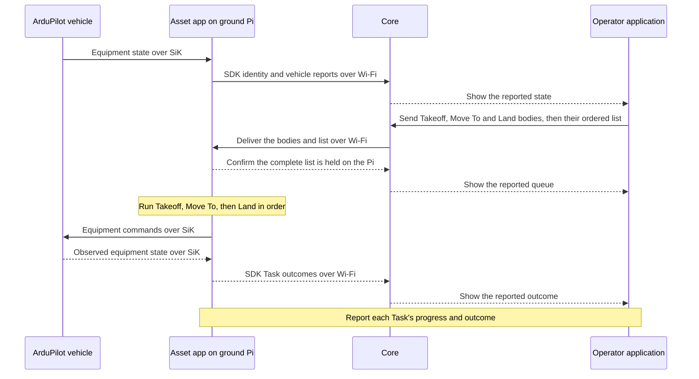

# First flight

The first setup uses a Raspberry Pi on the ground, connected to Core over Wi-Fi.
The Pi runs the Asset app and connects to an ArduPilot quadcopter through a SiK
radio link. It acts as the companion computer from the ground, much like using
a ground-control station such as QGroundControl.
The vehicle remains the Asset represented in Atlas.

The operator sends the whole task list: Takeoff, Move To a location, then Land.
The app on the Pi starts the list only after it holds every Task's body. It sends
equipment commands to the flight controller and reports the observed outcomes
through the SDK. The operator sees the reported vehicle behavior.

No runtime is built yet. The Pi can connect to Atlas while vehicle equipment is
still starting or unreachable. Connection alone does not establish takeoff
readiness. The operator can intervene locally at the Pi. Independent vehicle
controls and ArduPilot protections remain part of the setup, with their
configuration and handover procedure still to be defined and verified.

## The flight commands

- **Takeoff** has one input, a target altitude. The drone climbs straight up
  to it and holds there.
- **Move To** flies to a location.
- **Land** has a landing position and an optional transit altitude. The drone
  goes to that altitude, or stays at its current one, flies over the position,
  and lands.

These are the copter commands. Fixed-wing aircraft need a separate command
family with its own behavior. The copter commands are simpler than MAVLink and
ArduPilot commands but map onto them.
The Asset owns [platform-specific preparation and arming](https://github.com/atlas-field-systems/atlas/blob/main/asset/docs/README.md#prepare-and-take-off).

## Follow the work and its evidence

Core retains the requests and reported evidence. The Asset runtime coordinates
execution, and ArduPilot controls the vehicle. A request reaching Core or the Pi does
not prove that the flight controller received or executed an equipment command.
The SiK connection is an equipment link, not an Atlas Protocol transport or mesh.

## When something goes wrong

The ground Pi holds the Atlas task list. Whether it uploads a complete mission
to the flight controller remains open. Continued flight after SiK loss cannot
assume an onboard Atlas queue.

If Wi-Fi to Core drops but the Pi and SiK link keep working, the app retains its
queue and execution state. Configured Atlas failsafe conditions determine its
response. If SiK drops, the Pi may still report to Core, but it lacks current
vehicle evidence and cannot rely on sending a response to the flight controller.
Independent controller protections and the operator's intervention path handle
the failures they are configured to cover, including failure of the Pi itself.

A command failure cancels the remaining Tasks. For example, failed Takeoff
cancels Move To and Land. Core records cancellations when the app reports them.
Detected independent autopilot failsafe takeover also cancels ordinary work and
locks it for the operation. No configured response preserves cancelled Tasks.

Atlas [settings](settings.md) configure local conditions and response Tasks.
A response uses the same equipment execution as ordinary work. Return to home
can use Atlas execution or ArduPilot's own behavior, as selected for the setup.
A requested response is not proof that the vehicle returned or landed.

An applicable failsafe overrides ordinary work, including paused, and locks new
work for the rest of the operation, even after its response Task succeeds.
Local intervention and a manual runtime restart are required before another
operation. For this setup the runtime is on the ground Pi. Atlas does not manage
that recovery. Shutdown and log inspection follow the flight.
Atlas enables no failsafe rules by default. The flight setup explicitly supplies
the intended rules, including any battery response during an intentional wait.
The Asset owns
[the trigger conditions, cancellation rule, and remaining decisions](https://github.com/atlas-field-systems/atlas/blob/main/asset/docs/failsafes.md).

## Keep the whole run for debugging

When the operator spins them down, Core, each gateway, and each Asset each
write their own Reset ZIP. Core's ZIP holds:

- Every message in and out, in local arrival and send order, with credentials removed.
- Each Task's history: what was requested, accepted, and observed.
- Each device's last state and each Track's history.
- The run setup: devices, gateways, settings, and software versions.
- Errors, link drops, and the SDK's message-handling diagnostics.
- A plain readable summary: start and end, devices, Tasks, and outcomes.

Reset ZIPs are for after the system is used: dump them into an AI agent to give
it full context on how the system was used and any errors. Each system's
documentation defines its own ZIP contents and Reset procedure. Merging
several ZIPs into one is a separate process.

Core and Assets keep detailed local diagnostic logs alongside their normal state.
The SDK supplies events to the program using it, so those events join that
program's archive. Logging does not depend on sending diagnostic traffic over
the field link. See [Core logging](https://github.com/atlas-field-systems/atlas/blob/main/core/docs/logging.md),
[Asset logging](https://github.com/atlas-field-systems/atlas/blob/main/asset/docs/logging.md),
and [SDK logging](https://github.com/atlas-field-systems/atlas/blob/main/sdk/docs/logging.md).

This example explains one flight. Detailed Task, radio, and recovery rules
belong in their owning subsystem documentation.

[Charter home](README.md)
