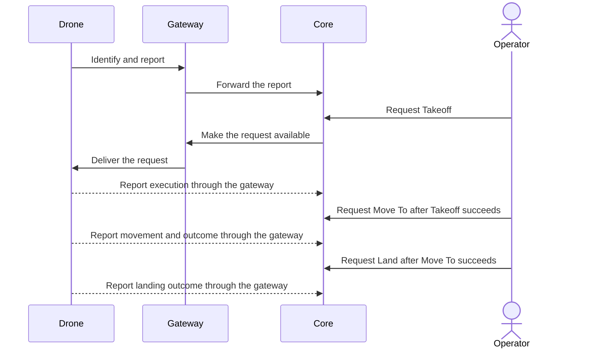

# First flight

## Story

The drone powers on, connects to Atlas through a gateway, and identifies itself.
I request Takeoff, then Move To a location, then Land, and see its reported outcomes.

This is the selected first workflow. Takeoff and Land are planned capabilities,
not claims about the current implementation.

## Flow

## What the story must make visible

- Connection keeps the Asset identity; received telemetry and two-way contact are distinct.
- Atlas retains requests. The Asset supplies evidence of actual execution.
- Ordinary telemetry supplies current state and three-dimensional history without a second reporting API.
- Losing a link or reply does not authorize repeating uncertain work.

After the flight, the [Reset story](operations.md) covers producing its archive.
Preloaded queues, camera concurrency, and Plugin jobs are separate stories; this
first sequence does not select their mechanisms.

[Charter home](README.md)
