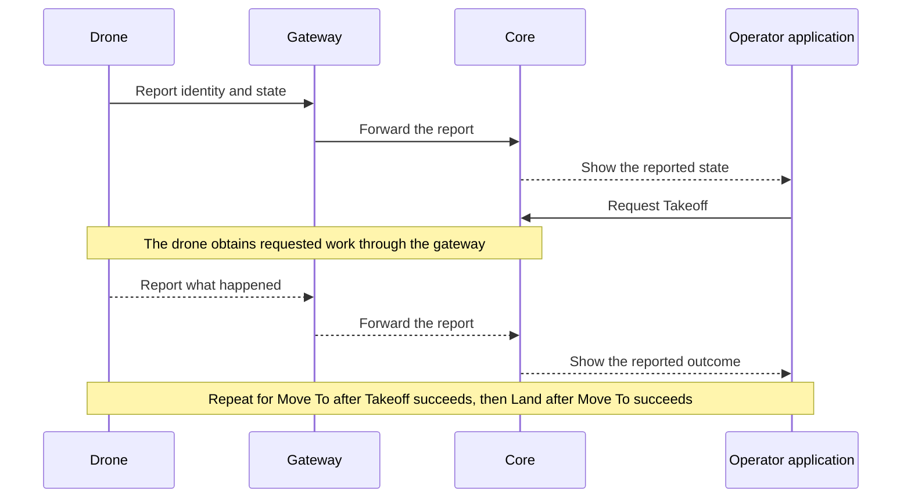

# First flight

The drone powers on and connects to Atlas through a gateway.
The operator requests Takeoff, then Move To a location, then Land.
The operator sees what the drone reports doing.

This is the selected first workflow. Takeoff and Land are planned capabilities,
not claims about the current implementation.

## Follow the work and its evidence

Core retains the requests and reported evidence. The Asset runtime performs the
physical action. A request reaching Core does not prove that the drone received
or executed it.

After the flight, the operator wants the run's operational history in a ZIP before
Reset clears it. The [run lifecycle plan](https://github.com/atlas-field-systems/atlas-core/blob/main/docs/support/operations.md)
defines that behavior and marks the detailed Reset procedure as a proposal.

This example explains one flight. Task scheduling, radio exchanges, and recovery
rules belong in their owning subsystem documentation.

[Charter home](README.md)
