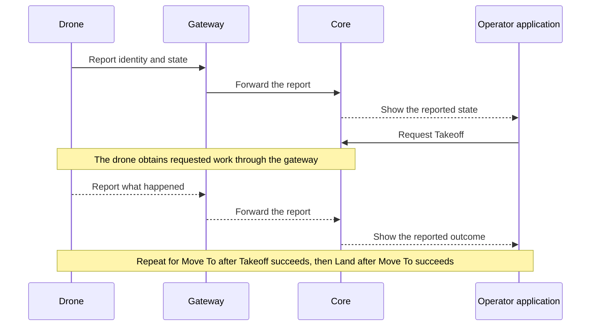

# First flight

The drone powers on and connects to Atlas through a gateway.
The operator requests Takeoff, then Move To a location, then Land.
The operator sees what the drone reports doing.

This is the selected first workflow. Takeoff and Land are planned capabilities,
not claims about the current implementation.

## The flight commands

- **Takeoff** has one input, a target altitude. The drone climbs straight up
  to it and holds there.
- **Move To** flies to a location.
- **Land** has a landing position and an optional transit altitude. The drone
  goes to that altitude, or stays at its current one, flies over the position,
  and lands.

These are simpler than MAVLink and ArduPilot commands but map onto them.

## Follow the work and its evidence

Core retains the requests and reported evidence. The Asset runtime performs the
physical action. A request reaching Core does not prove that the drone received
or executed it.

## Keep the whole run for debugging

When the operator spins them down, Core, each gateway, and each Asset each
write their own Reset ZIP. Core's ZIP holds:

- Every message in and out, in arrival order.
- Each Task's history: what was requested, accepted, and observed.
- Each device's last state and each Track's history.
- The run setup: devices, gateways, settings, and software versions.
- Errors and link drops.
- A plain readable summary: start and end, devices, Tasks, and outcomes.

After the run, all the ZIPs are gathered in one place. Together they show what
every part did, so the whole run can be analyzed at once, including by a
language model. Each system's documentation defines its own ZIP contents and
Reset procedure.

This example explains one flight. Task scheduling, radio exchanges, and recovery
rules belong in their owning subsystem documentation.

[Charter home](README.md)
