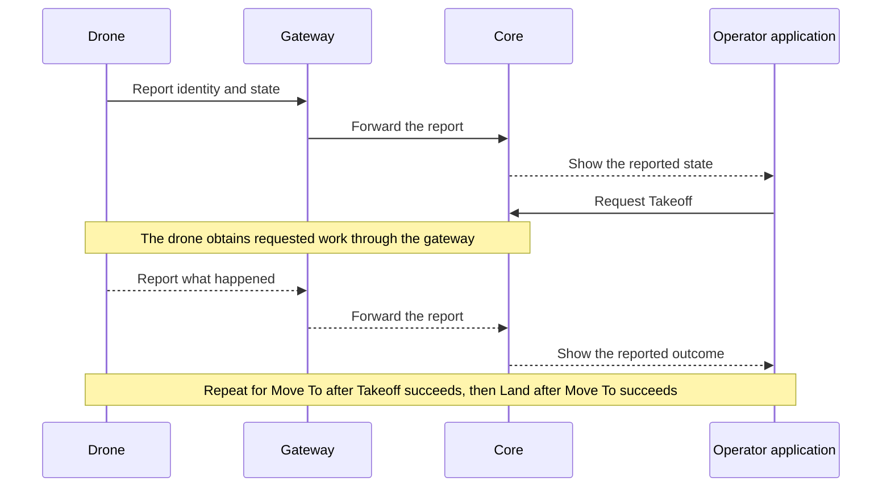

# First flight

The drone powers on and connects to Atlas through a gateway.
The operator requests Takeoff, then Move To a location, then Land.
The operator sees what the drone reports doing.

This is the selected first workflow. Takeoff and Land are planned capabilities,
not claims about the current implementation.

## The flight commands

- **Takeoff** has one input, a target altitude. The drone climbs straight up
  to it and holds there.
- **Move To** flies to a location.
- **Land** has a landing position and an optional transit altitude. The drone
  goes to that altitude, or stays at its current one, flies over the position,
  and lands.

These are simpler than MAVLink and ArduPilot commands but map onto them.

## Follow the work and its evidence

Core retains the requests and reported evidence. The Asset runtime performs the
physical action. A request reaching Core does not prove that the drone received
or executed it.

## When something goes wrong

If a Task in the queue fails, the drone cancels the remaining Tasks and follows
its emergency behavior. Core marks those Tasks cancelled once the drone reports
it, so the records match what happened.

Each Asset has [settings](settings.md) for how it responds to events such as
losing its radio link. Each trigger has its own response: continue the mission,
return to home, or land at a chosen point. Losing the link can be set to continue,
for example when Core rides in a car through a tunnel and the drone should keep
its mission and resync later. Return to home is done by an Atlas layer above the
flight controller or by ArduPilot's return-to-home mode.

Failure always wins. Every failure has a defined safe response, and it applies
whatever state the drone is in, including paused. An Asset never stays airborne
until it falls out of the sky.

## Keep the whole run for debugging

When the operator spins them down, Core, each gateway, and each Asset each
write their own Reset ZIP. Core's ZIP holds:

- Every message in and out, in arrival order.
- Each Task's history: what was requested, accepted, and observed.
- Each device's last state and each Track's history.
- The run setup: devices, gateways, settings, and software versions.
- Errors and link drops.
- A plain readable summary: start and end, devices, Tasks, and outcomes.

Reset ZIPs are for after the system is used: dump them into an AI agent to give
it full context on how the system was used and any errors. Each system's
documentation defines its own ZIP contents and Reset procedure. Merging
several ZIPs into one is a separate process.

This example explains one flight. Detailed Task, radio, and recovery rules
belong in their owning subsystem documentation.

[Charter home](README.md)
