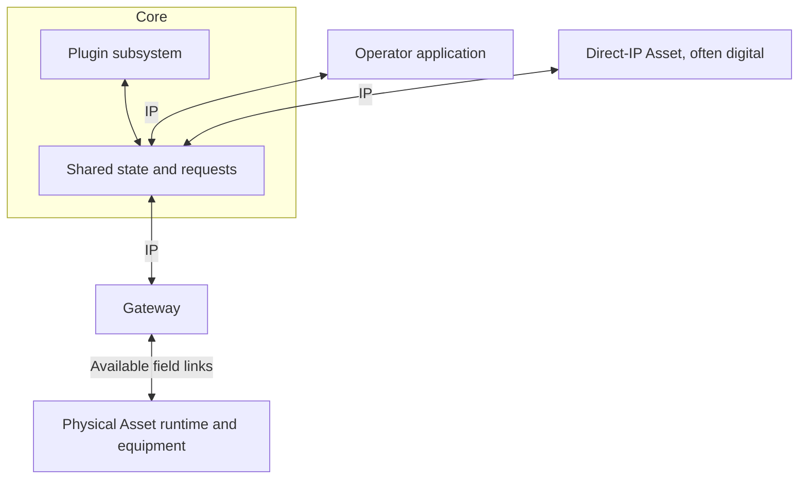

# Using Atlas

An operator application shows field information and lets a person request work.
Core holds the shared picture and the requests. A gateway carries traffic across
the field link. The Asset runtime controls its equipment and reports what happened.

## The usual field path

The direct-IP path is available. Most physical Assets use the gateway path.
Applications and gateways can use an SDK or the public API where appropriate.
The gateway represents the implementation used for that field link. Different
gateway implementations can coexist as [connectivity evolves](environment.md#connectivity-evolves).
The diagram shows system responsibilities, not process boundaries, wire messages,
or a required network topology.

## What the parts do

| Part | Responsibility |
| --- | --- |
| Operator application | Human interaction and presentation |
| Protocol and SDK | Shared contracts and client access |
| Core | Shared state, retained evidence, and requests for work |
| Gateway | Translation and forwarding across the field link |
| Asset runtime | Equipment control, local execution, and reports of its effects |
| Plugin subsystem within Core | Acquiring, analyzing, and publishing information |

## The four pillars

Entities describe Assets, their Observations, shared Tracks, and authored Geofeatures.
Tasks describe requested work and reported outcomes.
Objects hold files and their metadata.
Plugins bring information into Atlas, such as aircraft data or research about an area.
Their current intended role does not include controlling Assets.

Each subsystem's documentation defines its behavior. Authentication and
administration support the pillars.

## Information-focused stories

These stories describe intended use.

### Observe an aircraft

An ADS-B receiver is an Asset. It reports Observations about a passing aircraft.
Atlas uses those Observations as evidence to maintain a shared Track of the
aircraft for the operator to follow. The operator does not need to control that
aircraft to observe it through Atlas.

### Research a place

An operator selects a building or area and requests research from a Plugin within
Core. The Plugin publishes its findings through Entities and any files through
Objects. The operator can find those results in Atlas afterward.
The Plugin's request handling belongs in its subsystem documentation.

[First flight](first-flight.md) follows one complete use of these parts.
