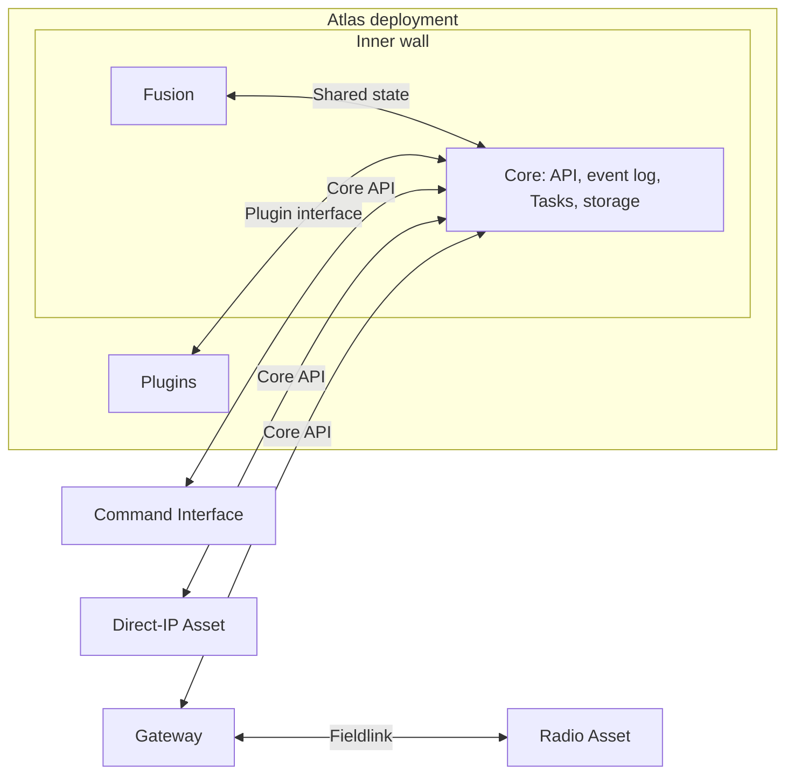

# Using Atlas

An operator uses the Command Interface to watch Assets and request work.
Core keeps the shared picture, the requests, and the event log. A gateway carries
Atlas across a field link. The Asset app controls its equipment and reports what
happened.

## The walled city

Core and Fusion sit inside the inner wall. Plugins sit in the second ring.
Everything else sits outside the city and reaches
Core only through the [Core API](https://github.com/atlas-field-systems/atlas/blob/main/core/docs/api.md).
[Design decisions](design-decisions.md#a-walled-city) has the layout.

Most physical Assets use the gateway path. The gateway and the radio Asset run the
same Fieldlink package for their field link. A direct-IP Asset, often a digital
one, calls the Core API itself. Different gateways can coexist as
[connectivity evolves](environment.md#connectivity-evolves). The diagram shows
responsibilities, not a required network topology.

The [first-flight setup](first-flight.md) runs the Asset app on a ground Raspberry
Pi that calls the Core API directly over IP, with no gateway. A separate SiK
equipment link connects that Pi to the ArduPilot vehicle. The app represents the
vehicle even though it is not aboard it.

## What the parts do

| Part | Responsibility |
| --- | --- |
| [Command Interface](https://github.com/atlas-field-systems/atlas/blob/main/command-interface/docs/README.md) | Human interaction and presentation |
| [Protocol](https://github.com/atlas-field-systems/atlas/blob/main/protocol/README.md) | The shared records and their one validator |
| [SDK](https://github.com/atlas-field-systems/atlas/blob/main/sdk/README.md) | The client for the Core API |
| Core | The shared picture, the event log, its [pillars](https://github.com/atlas-field-systems/atlas/blob/main/core/docs/pillars.md), and the Core API |
| Fusion | Combining evidence into the shared picture, inside Core |
| [Plugins](plugins.md) | Actions that gather and publish information |
| Gateway | Uplinking to the Core API and running Fieldlinks |
| Fieldlink | Carrying Atlas across one kind of field link |
| [Asset app](https://github.com/atlas-field-systems/atlas/blob/main/asset/docs/README.md) | Equipment control, local execution, failsafes, and reports of its effects |

## An operation runs without restarts

Core starts before any other part of an operation and stops after all of them.
Core never restarts during an operation. Gateways and Assets stay running too.
Links can drop and reconnect while those processes keep their state, and a
refreshed Command Interface recovers from Core's event log. An Asset restart is
rare. If one occurs, the system is spun down to evaluate the failure.

An Asset's [settings](settings.md) are its current configuration, kept in its entry.

## Information-focused stories

These stories describe intended use.

### Locate the tracker

A reporting-only Asset is a Raspberry Pi with a GPS peripheral and an uplink.
It obtains its own position and reports telemetry to Core for the operator.
It accepts no equipment-control commands. If it loses its GPS fix, Atlas
retains its last known position and the reported GPS condition. The tracker does
not send the old position as a new fix.

### Observe an aircraft

An ADS-B receiver is an Asset. It reports Observations about a passing aircraft.
Atlas uses those Observations as evidence to maintain a shared Track of the
aircraft for the operator to follow. The operator does not need to control that
aircraft to observe it through Atlas.

### Research a place

An operator selects a building or area and runs a Plugin action on it. The Plugin
returns a list, or publishes its findings through Entities and any files through
Objects. [Plugins](plugins.md) has the examples.

[First flight](first-flight.md) follows one complete use of these parts.
