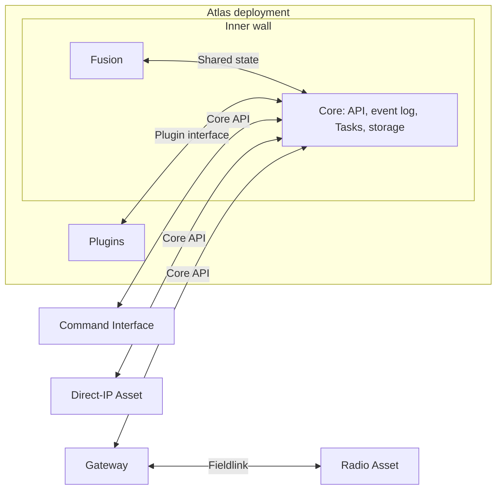

# Using Atlas

An operator uses the Command Interface to watch Assets and request work.
Core keeps the shared picture, the requests, and the event log. A gateway carries
Atlas across a field link. The Asset app controls its equipment and reports what
happened.

## The walled city

Core and Fusion sit inside the inner wall. Plugins sit in the second ring.
Everything else sits outside the city and reaches
Core only through the [Core API](https://github.com/atlas-field-systems/atlas/blob/main/core/docs/api.md).
[Design decisions](design-decisions.md#a-walled-city) has the layout.

Most physical Assets use the gateway path. The gateway and the radio Asset run the
same Fieldlink package for their field link. A direct-IP Asset, often a digital
one, calls the Core API itself. A site runs one gateway at a time, and the
gateway design can change as [connectivity evolves](environment.md#connectivity-evolves). The diagram shows
responsibilities, not a required network topology.

The [first-flight setup](first-flight.md) runs the Asset app on a ground Raspberry
Pi that calls the Core API directly over IP, with no gateway. A separate SiK
equipment link connects that Pi to the ArduPilot vehicle. The app represents the
vehicle even though it is not aboard it.

## What the parts do

| Part | Responsibility |
| --- | --- |
| [Command Interface](https://github.com/atlas-field-systems/atlas/blob/main/command-interface/docs/README.md) | Human interaction and presentation |
| [Protocol](https://github.com/atlas-field-systems/atlas/blob/main/protocol/README.md) | The shared records and their one validator |
| [SDK](https://github.com/atlas-field-systems/atlas/blob/main/sdk/README.md) | The client for the Core API |
| Core | The shared picture, the event log, its [pillars](https://github.com/atlas-field-systems/atlas/blob/main/core/docs/pillars.md), and the Core API |
| Fusion | Combining evidence into the shared picture, inside Core |
| [Plugins](plugins.md) | Actions that gather and publish information |
| [Gateway](https://github.com/atlas-field-systems/atlas/blob/main/gateway/README.md) | Uplinking to the Core API and running Fieldlinks |
| Fieldlink | Carrying Atlas across one kind of field link |
| [Asset app](https://github.com/atlas-field-systems/atlas/blob/main/asset/docs/README.md) | Equipment control, local execution, failsafes, and reports of its effects |

## An operation runs without planned restarts

Core starts before any other part of an operation and stops after all of them.
Each start of Core begins a new, empty run, and stopping Core on purpose ends it
([Runs and identity](runs-and-identity.md)). Nobody restarts Core during an
operation. If it crashes, it resumes the same run when it starts again, and
everyone reconnects. Gateways and Assets stay running too.
Links can drop and reconnect while those processes keep their state, and a
refreshed Command Interface recovers from Core's event log.

An Asset whose app stops shows offline in Core, and the other Assets keep
working. After a crash the app restarts itself and rejoins as the same Asset
with the same ID, because its key proves which Asset it is, but its work does
not resume. An Asset that restarts while flying fires its failsafe
([Runs and identity](runs-and-identity.md#keys-and-registration)). An Asset
that crashed is inspected before its next flight. An Asset keeps nothing from an
earlier run. A dropped link is not a stop: the app keeps its state and
reconnects as the same Asset.

An Asset's [settings](settings.md) are its current configuration, kept in its entry.

## Information-focused stories

These stories describe intended use.

### Locate the tracker

A reporting-only Asset is a Raspberry Pi with a GPS peripheral and an uplink.
It obtains its own position and reports telemetry to Core for the operator.
It accepts no equipment-control commands. If it loses its GPS fix, Atlas
retains its last known position and the reported GPS condition. The tracker does
not send the old position as a new fix.

### Observe an aircraft

An ADS-B receiver is an Asset. It reports Observations about a passing aircraft.
Atlas uses those Observations as evidence to maintain a shared Track of the
aircraft for the operator to follow. The operator does not need to control that
aircraft to observe it through Atlas.

### Research a place

An operator selects a building or area and runs a Plugin action on it. The Plugin
returns a list, or creates geo features and stores files as Objects. Every
operator sees the call and its result. [Plugins](plugins.md) has the examples.

### Attach a photo to a place

An operator uploads a photo and attaches it to a building's geo feature. Every
operator can open it from that place. If it was the wrong building, the operator
moves it; if it was the wrong photo, the operator deletes it, and history keeps
the record of both.

[First flight](first-flight.md) follows one complete use of these parts.
