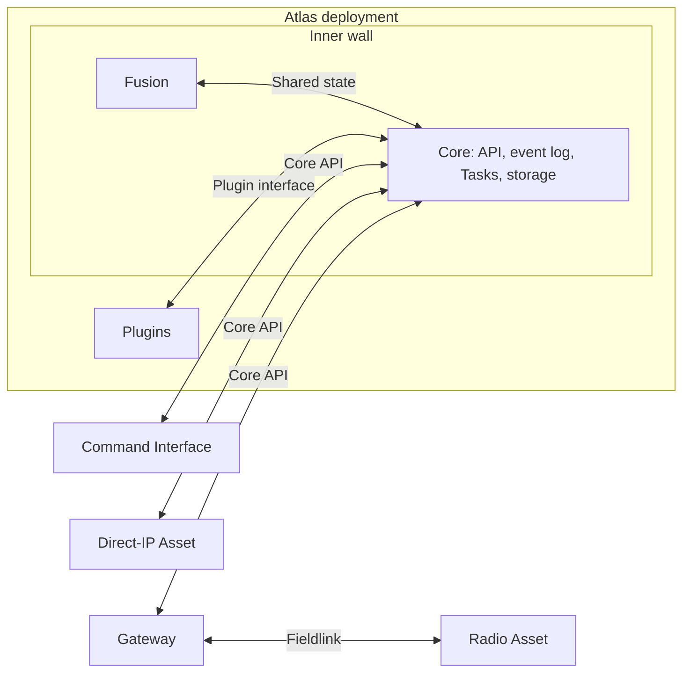

# Using Atlas

This page describes the intended operation. See the [repository overview](https://github.com/atlas-field-systems/atlas/blob/main/README.md)
for what is built and what remains planned.

An operator uses the Command Interface to watch Assets and request work.
Core keeps the shared picture, the requests, and the event log. A gateway carries
Atlas across a field link. The Asset app controls its equipment and reports what
happened.

## The walled city

The city is laid out in rings
([ADR-0020](https://github.com/atlas-field-systems/atlas/blob/main/docs/adr/0020-atlas-is-a-walled-city.md), proposed):

- **Inside the inner wall.** Core and Fusion run in one process. Core is built
  from [pillars](https://github.com/atlas-field-systems/atlas/blob/main/core/docs/pillars.md)
  over shared storage and the event log. Fusion works on Core's state
  directly, never through the public API.
- **The second ring.** Each Plugin is its own program. It connects out to Core
  with its own key and reaches Core only through the Plugin interface, never
  its storage. Core never calls a Plugin and never runs one in its own process.
  The Plugin interface is the Core API calls a Plugin's key may use, not a
  second protocol.
- **Outside the city.** Gateways, Assets, and operator applications reach Core
  only through the public
  [Core API](https://github.com/atlas-field-systems/atlas/blob/main/core/docs/api.md).

Most physical Assets use the gateway path, through the gateway's one
[Fieldlink](https://github.com/atlas-field-systems/atlas/blob/main/fieldlink/README.md). A direct-IP Asset calls the
Core API itself. A Core may run several gateways, each on its own radio network
([Scale](scale.md#setup)), and the
gateway design can change as [connectivity evolves](environment.md#connectivity-evolves). The diagram shows
responsibilities, not a required network topology.

The [first-flight setup](first-flight.md) is a direct-IP Asset. A ground
Raspberry Pi runs the Asset app for the ArduPilot vehicle, through the
[SiK tool](https://github.com/atlas-field-systems/atlas/blob/main/tools/sik/README.md),
and talks to the vehicle over a SiK radio. The app represents the vehicle even
though it is not aboard it.

## What the parts do

| Part | Responsibility |
| --- | --- |
| [Command Interface](https://github.com/atlas-field-systems/atlas/blob/main/command-interface/docs/README.md) | Human interaction and presentation |
| [Protocol](https://github.com/atlas-field-systems/atlas/blob/main/protocol/README.md) | The shared records and their one validator |
| [SDK](https://github.com/atlas-field-systems/atlas/blob/main/sdk/README.md) | The client for the Core API |
| Core | The shared picture, the event log, its [pillars](https://github.com/atlas-field-systems/atlas/blob/main/core/docs/pillars.md), and the Core API |
| Fusion | Combining evidence into the shared picture, inside Core |
| [Plugins](plugins.md) | Actions that gather and publish information |
| [Gateway](https://github.com/atlas-field-systems/atlas/blob/main/gateway/README.md) | Uplinking to the Core API and running Fieldlinks |
| Fieldlink | Carrying Atlas across one kind of field link |
| [Asset app](https://github.com/atlas-field-systems/atlas/blob/main/asset/docs/README.md) | Equipment control, local execution, failsafes, and reports of its effects |
| [Atlas Tools](https://github.com/atlas-field-systems/atlas/blob/main/tools/README.md) | Ready setups that package these parts for one kind of equipment |

## An operation runs without planned restarts

Core starts before any other part of an operation and stops after all of them.
Each start of Core begins a new, empty run, and stopping Core on purpose ends it
([Runs and identity](runs-and-identity.md)). Nobody restarts Core during an
operation. If it crashes, it resumes the same run when it starts again, and
everyone reconnects. Gateways and Assets stay running too.
Links can drop and reconnect while those processes keep their state, and a
refreshed Command Interface recovers from Core's event log.

An Asset whose app stops shows offline in Core, and the other Assets keep
working. Nothing restarts the app on its own. If it fails in flight, the flight
controller returns the vehicle home without Atlas, and the vehicle is inspected
before its next flight. An app started again on the ground in the same run
rejoins as the same Asset with the same ID, because its key proves which Asset
it is, but its work does not resume
([Runs and identity](runs-and-identity.md#keys-and-registration)). An Asset keeps nothing from an
earlier run. A dropped link is not a stop: the app keeps its state and
reconnects as the same Asset.

An Asset's [settings](settings.md) are its current configuration, kept in its entry.

## Information-focused stories

These stories describe intended use.

### Locate the tracker

A reporting-only Asset is a Raspberry Pi with a GPS peripheral and an uplink.
It obtains its own position and reports telemetry to Core for the operator.
It accepts no equipment-control commands. If it loses its GPS fix, Atlas
retains its last known position and the reported GPS condition. The tracker does
not send the old position as a new fix.

### Observe an aircraft

An ADS-B receiver is an Asset. It reports Observations about a passing aircraft.
Atlas uses those Observations as evidence to maintain a shared Track of the
aircraft for the operator to follow. The operator does not need to control that
aircraft to observe it through Atlas.

### Research a place

An operator selects a building or area and runs a Plugin action on it. The Plugin
returns a list, or creates geo features and stores files as Objects. Every
operator sees the call and its result. [Plugins](plugins.md) has the examples.

### Attach a photo to a place

An operator uploads a photo and attaches it to a building's geo feature. Every
operator can open it from that place. If it was the wrong building, the operator
moves it; if it was the wrong photo, the operator deletes it, and history keeps
the record of both.

[First flight](first-flight.md) follows one complete use of these parts.
