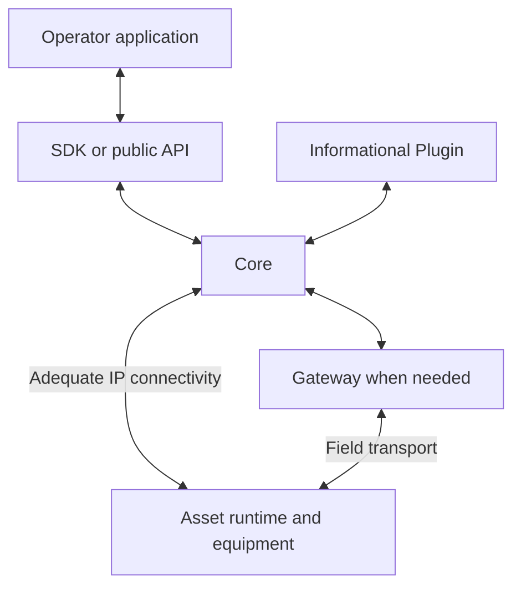

# Using Atlas

## Story

I use an operator application to see field information and request work. An Asset
with adequate IP connectivity speaks to Core directly. A gateway translates other
field transports. The Asset runtime performs the physical action.

## Flow

## Responsibilities

| Part | Owns |
| --- | --- |
| Operator application | Human interaction and presentation |
| SDK | Client requests, response handling, and optional live picture |
| Protocol | Shared meanings and exact exchanges |
| Core | Accepted records, current state, history, and public operations |
| Gateway, when needed | Translation and forwarding across the field link |
| Asset runtime | Physical execution, local execution state, and its evidence |
| Plugin | Acquiring, analyzing, and publishing information |

The [first flight](first-flight.md) deliberately uses a gateway; other Assets need not.
The selected SDK direction is HTTP by default with opt-in in-memory Full
synchronization. History is requested explicitly rather than downloaded with live state.

Reconnection preserves identity and reconciles existing work. It does not authorize
repeating an uncertain physical action. Local persistence and recovery details belong
to each runtime and need explicit contracts where components depend on them.

[Charter home](README.md)
