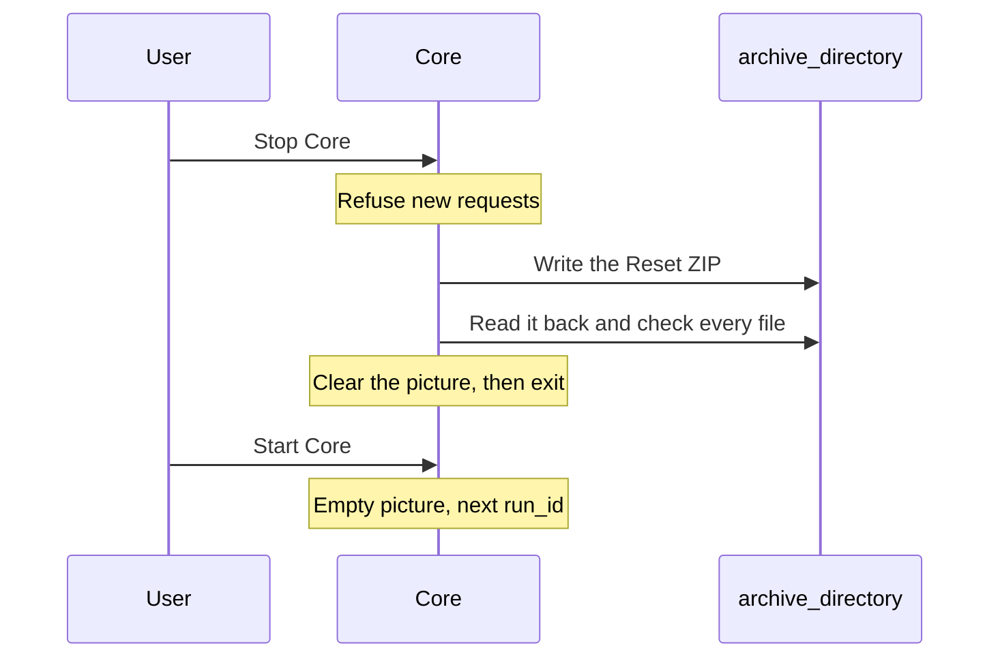

# Core Reset

**Built.** Stopping Core is Reset: Core writes and checks its Reset ZIP before
clearing the picture.
[Reset and identity](../../atlas/reset-and-identity.md) owns the rules this page
carries out: what Reset is, what carries over, and signing in again.
[Storage](storage.md#reset-and-run_id) says where the data lives. [Logging](logging.md)
says what Core records before a Reset.

## Stopping Core is Reset

The user starts and stops Core on Core's own computer. A host shutdown or a
container stop is a stop too.

- **Starting Core** begins an empty picture with the next `run_id`, unless
  Core was never stopped: then Core [keeps the picture](#when-core-stops-unexpectedly).
  `run_id` is the built name of the counter that changes at each Reset.
- **Stopping Core** is Reset. Core stops accepting requests, writes its Reset
  ZIP, checks it, clears the picture, and exits.
- **Shut the Assets down first.** Core does not check. An Asset left running
  across a Reset is not supported: Task numbers start again at 1 after each
  Reset.
- **Gateways and Plugins stay running.** Each one notices the new `run_id` when
  Core comes back ([Basics](api.md#basics)).

Requests already in progress when the stop begins may finish within a
five-second grace period. Requests that start after the stop begins receive
`503 stopping`, including on new connections throughout the five seconds. Core
then closes the remaining connections before writing the Reset ZIP.

## Core's Reset ZIP

Core writes one ZIP at each Reset into `archive_directory` ([configuration](../config.md)),
named `core-run-<run_id>-<start>.zip`, where `<start>` is when Core first
started with that `run_id`, in UTC as `YYYYMMDDTHHMMSSZ`. The ZIP holds only
what Core observed. Asset and gateway ZIPs are separate evidence, and merging
several ZIPs into one is a separate process.

| File | Holds |
| --- | --- |
| `README.md` | What each file is, so an AI agent or a person can find their way |
| `summary.md` | The plain readable summary below |
| `manifest.json` | Every file with its size and SHA-256, each unexpected stop Core resumed from, and every known gap |
| `events.jsonl` | The [event log](api.md#the-event-log-and-live-stream) since the last Reset, one event per line in `event_id` order: every accepted domain request and stored report |
| `state/` | The current-state rows at the stop, one JSON Lines file per table: Tasks, queues, geo features, Objects, and the Assets, gateways, and Plugins seen |
| `objects/` | Each Object's file, named by its `object_id`, including Objects deleted since the last Reset; `state/` marks those deleted |
| `diagnostics/` | Core's [diagnostic log](logging.md) since the last Reset, as written |
| `config.json` | The resolved configuration, with secrets removed |
| `versions.json` | Core's version, the Protocol package version, and the definitions hash |

Removed gateways and Plugins keep their state rows marked removed, as Assets do.
Their credentials stop working immediately; the checked clear removes those rows.

`summary.md` says, in plain words:

- The `run_id`, when Core started and stopped, and each time Core stopped
  unexpectedly and kept the picture, with how long it was down.
- Each Asset's ID, its gateway if any, and the first and last times Core
  received evidence of that Asset. A gateway can replay contact on reconnect,
  so Core's receipt time can be later than the radio contact.
- Each Asset's Tasks in order, with their final reported outcome, or no
  reported outcome. A dropped Task also names any later reported final outcome,
  while remaining dropped in Core.
- Plugin calls and how each ended.
- Every gap: records lost, truncated, or never written, and when.

No file in the ZIP holds a credential: no password, password hash, key, key
hash, or session token.

## Check, then clear

Core writes the ZIP under a temporary name, reads it back, and checks every file
against `manifest.json`. Only then does it give the ZIP its final name and clear
the picture. A ZIP with any other name is not a Reset ZIP. Once the ZIP has its
final name and has passed the check, the Reset is done
([ADR-0005](../../docs/adr/0005-the-reset-zip-is-the-only-copy.md)).

Clearing removes everything held since the last Reset: events, Assets, Tasks,
queues, geo features, Objects and their files, idempotency keys,
sessions, and diagnostic files. Accounts and keys stay
([what carries over](../../atlas/reset-and-identity.md#what-carries-over)).
Operator applications drop what they held when they see the new `run_id`
([Core API basics](api.md#basics)). Gateways and Plugins start offline after
the Reset until they are heard.

The ZIP is then the only copy. Core never deletes a ZIP. The owner deletes old
ZIPs by hand.

## When the ZIP fails

If Core cannot finish or check the ZIP, for example because the disk is full,
it deletes nothing. It keeps the data as it was, records the failure in its
diagnostics, prints it, and removes the incomplete file, so a failed export
never looks like a finished ZIP.

Core does not try again, and Atlas has no export or retry feature for that
data. The next start begins an empty picture as usual, and the old data stays
in the database for the admin to handle by hand
([storage](storage.md#reset-and-run_id)).

A failed startup cancels its contact deadlines before closing storage; it leaves
no contact work running against the stopped Core.

## When Core stops unexpectedly

A crash, a power loss, or a reboot that was not a stop does not clear the
picture ([Reset and identity](../../atlas/reset-and-identity.md#the-picture-and-reset)).
Every accepted change was written with its event ([storage](storage.md)), so
at its next start Core finds the `run_id` that was never stopped and keeps
going: the same `run_id`, Assets and their IDs, Tasks and their numbering,
places, Objects, sessions, and idempotency keys. It writes no ZIP and clears
nothing. The last sign of life is the newer of the last event and diagnostic
record; the resulting downtime is an estimate.

- Callers reconnect as after a dropped link. Operator applications and
  gateways see the same `run_id` on `GET /about` and resume their event streams
  from their last `event_id`. Assets on IP reconnect as the same Assets.
- Core's contact view starts again. An Asset, gateway, or Plugin it has not
  heard from within `offline_after_s` of the start shows offline, and the
  [offline rules](api.md#operator-requests) apply as usual.
- Core records the stop and the resume in its diagnostics, and the next Reset
  ZIP lists them as a gap.

A crash while Core is stopping depends on how far the ZIP got:

- **The ZIP was checked.** If a final-named ZIP is already there, the Reset is
  done. Core checks the ZIP again, finishes the clear, and starts an empty
  picture.
- **The ZIP was not checked.** Core removes any incomplete ZIP file and keeps
  the picture, as after any crash. The user stops Core again to Reset.

If a final-named ZIP fails its check again at the next start, Core keeps the
picture and refuses to overwrite that ZIP on the next stop.

## Scenarios

Behavior tests come from these, once Core exists.

- Fly a short flight, stop the Asset, then stop Core. `archive_directory` holds
  one ZIP whose summary lists the Asset, its Tasks and their outcomes. Start
  Core: the map is empty and lists no Assets, every account must sign in
  again, and accounts still work. Start the Asset: it registers as a new Asset
  with the ID Core assigns.
- Open a link to a Task made before a Reset. The operator application says it
  was made before the last Reset and does not show the new Task with the same
  ID.
- Store an Object, then stop Core. The ZIP holds the file under `objects/`;
  after the Reset there are no Objects.
- Fill the disk, then stop Core. No ZIP appears under its final name, Core
  prints the failure, and the data stays. Free space and start Core: an empty
  picture starts.
- Kill Core, then start it. No ZIP appears. `GET /about` shows the same
  `run_id`, the Assets keep their IDs, and the next Task an operator sends gets
  the next `task_id`. Stop Core: the ZIP lists the unexpected stop as a gap.
- Kill Core while it writes its ZIP, before the check, then start it. No ZIP
  appears, and `GET /about` shows the same `run_id`.
- Search every file of a ZIP for a password, a key, and a session token used
  before the Reset. None appears.
