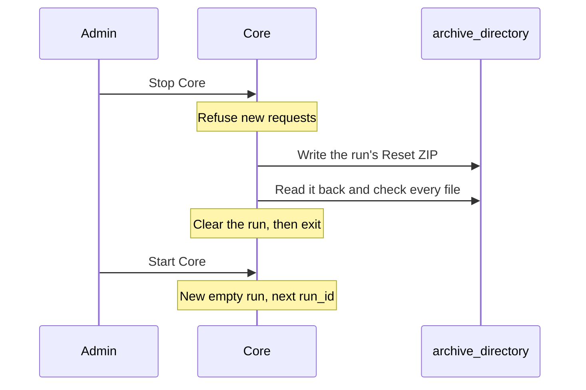

# Core Reset

This design is selected but not implemented. It says how a run ends, what Core
writes into its Reset ZIP, and what it clears. [Storage](storage.md#runs) says
where a run's data lives. [Logging](logging.md) says what Core records during
the run.

## Stopping Core ends the run

A run is everything between one start of Core and the next stop. There is no
Reset request, no Core API call, and no Command Interface button. The admin
starts and stops Core on Core's own computer.

- **Starting Core** begins a new, empty run with the next `run_id`.
- **Stopping Core** ends the run. Core stops accepting requests, writes its
  Reset ZIP, checks it, clears the run, and exits.
- **Shut the Assets down first.** The operator is trusted to stop every Asset
  before stopping Core. Core does not check. An Asset left running into the
  next run is not supported: Task numbers start again at 1 in each run.
- **Gateways and Plugins stay running.** Each one notices the new `run_id` when
  Core comes back ([Basics](api.md#basics)).

## Core's Reset ZIP

Core writes one ZIP per run into `archive_directory` ([configuration](../config.md)),
named `core-run-<run_id>-<start>.zip`, where `<start>` is the run's start in UTC
as `YYYYMMDDTHHMMSSZ`. The ZIP holds only what Core observed. Asset and gateway
ZIPs are separate evidence, and merging several ZIPs into one is a separate
process.

| File | Holds |
| --- | --- |
| `README.md` | What each file is, so an AI agent or a person can find their way |
| `summary.md` | The plain readable summary below |
| `manifest.json` | Every file with its size and SHA-256, whether the run ended normally, and every known gap |
| `events.jsonl` | The run's [event log](api.md#the-event-log-and-live-stream), one event per line in `event_id` order: every accepted request and stored report |
| `state/` | The run's current-state rows when it ended, one JSON Lines file per table: Tasks, queues, Tracks, geo features, Objects, and the Assets, gateways, and Plugins seen |
| `objects/` | Each Object's file, named by its `object_id` |
| `diagnostics/` | Core's [diagnostic log](logging.md) for the run, as written |
| `config.json` | The resolved configuration, with secrets removed |
| `versions.json` | Core's version, the Protocol package version, and the definitions hash |

`summary.md` says, in plain words:

- The run's ID, its start and end, and how it ended: stopped normally, or
  stopped unexpectedly and possibly incomplete.
- Each Asset that took part: its ID, its gateway if any, and when Core first
  and last heard it.
- Each Asset's Tasks in order, with their final reported outcome, or no
  reported outcome.
- Plugin calls and how each ended.
- Every gap: records lost, truncated, or never written, and when.

No file in the ZIP holds a credential: no password, password hash, key, key
hash, or session token.

## Check, then clear

Core writes the ZIP under a temporary name, reads it back, and checks every file
against `manifest.json`. Only then does it give the ZIP its final name and clear
the run. A ZIP with any other name is not a Reset ZIP.

Clearing removes everything that belongs to the run: its events, Tasks, queues,
Tracks, geo features, Objects and their files, idempotency keys, and diagnostic
files. Sessions end too, so operators log in again in the next run. Core keeps
what is not part of any run: accounts, the Assets, gateways, and Plugins an
admin set up with their key hashes, and each radio Asset's `asset_id` and radio
identity. Each Asset, gateway, and Plugin starts the next run offline until it
is heard. An Asset sends its description again when it connects.

The ZIP is then the only copy of the run. Core never deletes a ZIP. The owner
deletes old ZIPs by hand.

## When the ZIP fails

If Core cannot finish or check the ZIP, for example because the disk is full,
it clears nothing. It keeps the run's data as it was, records the failure in
its diagnostics, prints it, and removes the incomplete file, so a failed export
never looks like a finished ZIP.

At every start, before the new run begins, Core tries again to write the ZIP of
each earlier run it still holds. A run whose ZIP fails again stays held; the new
run starts anyway and Core prints which runs are still held. The new run never
waits for an old run's ZIP.

## When Core stops unexpectedly

If Core crashes or loses power, the run ends there. At its next start, Core
writes that run's ZIP as above. Its `summary.md` and `manifest.json` say "Core
stopped unexpectedly; this record may be incomplete", and give the last event
and the last diagnostic record Core holds. Core then starts a new run. It never
continues an interrupted run.

## Scenarios

Behavior tests come from these, once Core exists.

- Run a short flight, stop the Asset, then stop Core. `archive_directory` holds
  one ZIP whose summary lists the Asset, its Tasks and their outcomes. Start
  Core: the map is empty, the Asset is offline, and accounts still log in.
- Store an Object in a run, then stop Core. The ZIP holds the file under
  `objects/`; the next run has no Objects.
- Fill the disk, then stop Core. No ZIP appears under its final name, and Core
  prints the failure. Free space and start Core: the earlier run's ZIP is
  written before the new run starts.
- Kill Core during a run, then start it. A ZIP marked as stopped unexpectedly
  appears, and a new run starts.
- Search every file of a ZIP for a password, a key, and a session token used in
  the run. None appears.
