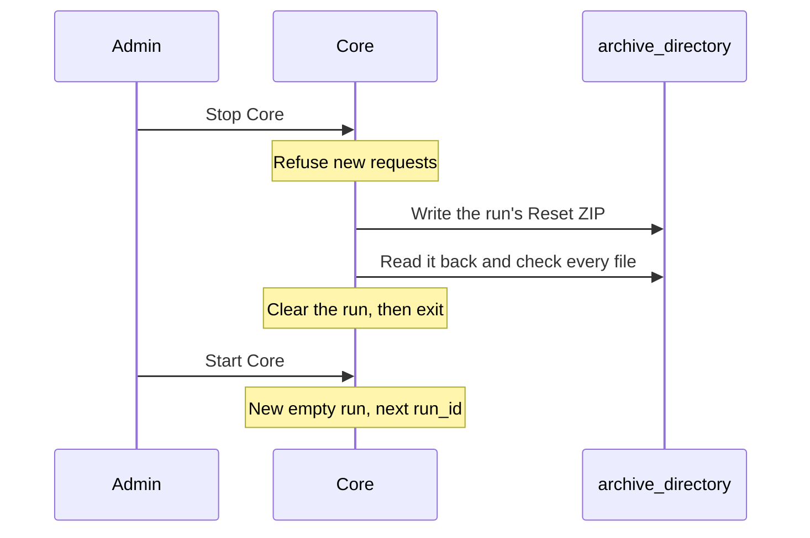

# Core Reset

This design is selected but not implemented. It says how Core ends a run, what
it writes into its Reset ZIP, and what it clears.
[Runs and identity](../../atlas/runs-and-identity.md) owns the rules this page
carries out: what a run is, what carries over, and signing in again.
[Storage](storage.md#runs) says where a run's data lives. [Logging](logging.md)
says what Core records during the run.

## Stopping Core ends the run

The admin starts and stops Core on Core's own computer.

- **Starting Core** begins a new, empty run with the next `run_id`, unless the
  last run never stopped: then Core [resumes it](#when-core-stops-unexpectedly).
- **Stopping Core** on purpose ends the run. Core stops accepting requests, writes its
  Reset ZIP, checks it, clears the run, and exits.
- **Shut the Assets down first.** Core does not check. An Asset left running
  into the next run is not supported: Task numbers start again at 1 in each run.
- **Gateways and Plugins stay running.** Each one notices the new `run_id` when
  Core comes back ([Basics](api.md#basics)).

Requests in progress have five seconds to finish during deliberate stop. Core then
closes the remaining connections before writing the Reset ZIP.

## Core's Reset ZIP

Core writes one ZIP per run into `archive_directory` ([configuration](../config.md)),
named `core-run-<run_id>-<start>.zip`, where `<start>` is the run's start in UTC
as `YYYYMMDDTHHMMSSZ`. The ZIP holds only what Core observed. Asset and gateway
ZIPs are separate evidence, and merging several ZIPs into one is a separate
process.

| File | Holds |
| --- | --- |
| `README.md` | What each file is, so an AI agent or a person can find their way |
| `summary.md` | The plain readable summary below |
| `manifest.json` | Every file with its size and SHA-256, each unexpected stop Core resumed from, and every known gap |
| `events.jsonl` | The run's [event log](api.md#the-event-log-and-live-stream), one event per line in `event_id` order: every accepted domain request and stored report |
| `state/` | The run's current-state rows when it ended, one JSON Lines file per table: Tasks, queues, Tracks, geo features, Objects, and the Assets, gateways, and Plugins seen |
| `objects/` | Each Object's file, named by its `object_id`, including Objects deleted during the run; `state/` marks those deleted |
| `diagnostics/` | Core's [diagnostic log](logging.md) for the run, as written |
| `config.json` | The resolved configuration, with secrets removed |
| `versions.json` | Core's version, the Protocol package version, and the definitions hash |

`summary.md` says, in plain words:

- The run's ID, its start and end, and each time Core stopped unexpectedly
  and resumed the run, with how long it was down.
- Each Asset that took part: its ID, its gateway if any, and when Core first
  and last heard it.
- Each Asset's Tasks in order, with their final reported outcome, or no
  reported outcome.
- Plugin calls and how each ended.
- Every gap: records lost, truncated, or never written, and when.

No file in the ZIP holds a credential: no password, password hash, key, key
hash, or session token.

## Check, then clear

Core writes the ZIP under a temporary name, reads it back, and checks every file
against `manifest.json`. Only then does it give the ZIP its final name and clear
the run. A ZIP with any other name is not a Reset ZIP.

Clearing removes everything that belongs to the run: its events, Assets, Tasks,
queues, Tracks, geo features, Objects and their files, idempotency keys,
sessions, and diagnostic files. Accounts and keys stay
([what carries over](../../atlas/runs-and-identity.md#what-carries-over)).
Operator applications drop what they held when they see the new `run_id`
([Core API basics](api.md#basics)). Gateways and Plugins start the next run
offline until they are heard.

The ZIP is then the only copy of the run. Core never deletes a ZIP. The owner
deletes old ZIPs by hand.

## When the ZIP fails

If Core cannot finish or check the ZIP, for example because the disk is full,
it clears nothing. It keeps the run's data as it was, records the failure in
its diagnostics, prints it, and removes the incomplete file, so a failed export
never looks like a finished ZIP.

Core does not try again. The next start begins a new run as usual, and the old
run's data stays in the database until the admin removes it
([storage](storage.md#runs)).

## When Core stops unexpectedly

If the open run already has a final-named ZIP, Core checks it again and
finishes the clear before starting a new run. If it fails the check, Core
resumes the run and refuses to overwrite that ZIP on the next stop.
The last sign of life is the newer of the last event and diagnostic record;
the resulting downtime is an estimate. Plugins receive the same fresh contact
window as Assets and gateways.

A crash, a power loss, or a reboot that was not a deliberate stop does not end
the run ([Runs and identity](../../atlas/runs-and-identity.md#a-run-and-reset)).
Every accepted change was written with its event ([storage](storage.md)), so
at its next start Core finds the run that never stopped and resumes it: the same
`run_id`, Assets and their IDs, Tasks and their numbering, places, Objects,
sessions, and idempotency keys. It writes no ZIP and clears nothing.

- Callers reconnect as after a dropped link. Operator applications and
  gateways see the same `run_id` on `GET /about` and resume their event streams
  from their last `event_id`. Assets on IP reconnect within the run.
- Core's contact view starts again. An Asset or gateway it has not heard from
  within `offline_after_s` of the start shows offline, and the
  [offline rules](api.md#operator-requests) apply as usual.
- Core records the stop and the resume in its diagnostics, and the run's ZIP
  lists them as a gap.

A crash while Core is already stopping is treated the same way: the next start
removes any incomplete ZIP file and resumes the run. The admin stops Core again
to end it.

## Scenarios

Behavior tests come from these, once Core exists.

- Run a short flight, stop the Asset, then stop Core. `archive_directory` holds
  one ZIP whose summary lists the Asset, its Tasks and their outcomes. Start
  Core: the map is empty and lists no Assets, every account must sign in
  again, and accounts still work. Start the Asset: it registers as a new Asset
  with the ID Core assigns.
- Open a link to a Task from the earlier run after Reset. The operator
  application says it belongs to an ended run and does not show the new run's
  Task with the same ID.
- Store an Object in a run, then stop Core. The ZIP holds the file under
  `objects/`; the next run has no Objects.
- Fill the disk, then stop Core. No ZIP appears under its final name, Core
  prints the failure, and the run's data stays. Free space and start Core: a
  new run starts.
- Kill Core during a run, then start it. No ZIP appears. `GET /about` shows the
  same `run_id`, the Assets keep their IDs, and the next Task an operator sends
  gets the next `task_id`. Stop Core: the ZIP lists the unexpected stop as a gap.
- Kill Core while it writes its ZIP, then start it. No ZIP appears, and
  `GET /about` shows the same `run_id`.
- Search every file of a ZIP for a password, a key, and a session token used in
  the run. None appears.
